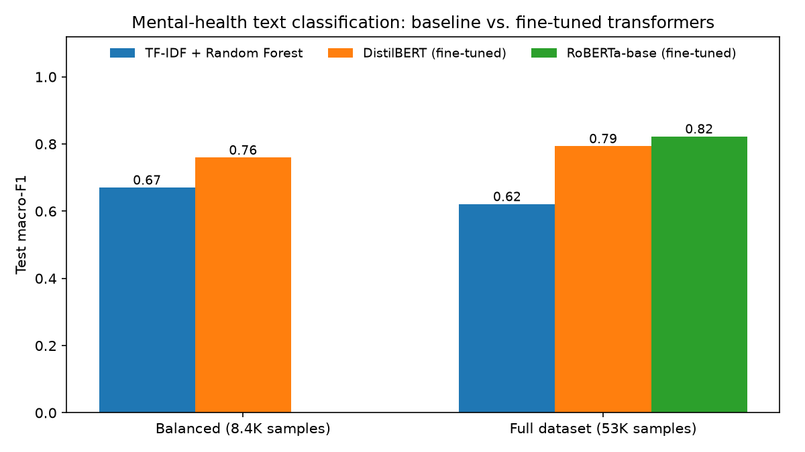
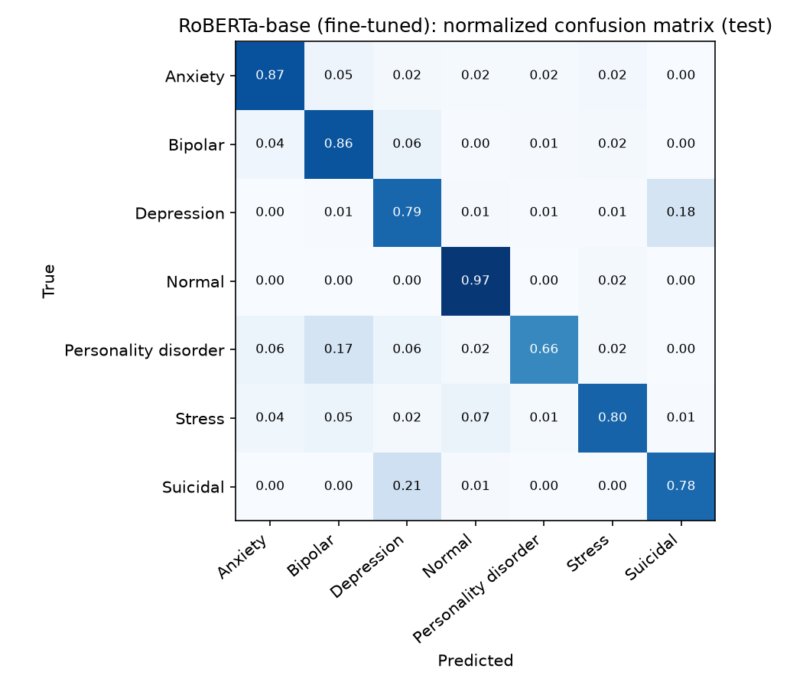

# Mental Health Text Classifier

An NLP project that classifies short texts, such as social-media posts and chat messages, into 7 mental-health categories: *Normal, Depression, Suicidal, Anxiety, Bipolar, Stress, Personality disorder*. It compares a classical **TF-IDF + Random Forest** baseline with fine-tuned **transformers (DistilBERT and RoBERTa)**, and includes a **Flask** web app and a desktop app.

> ⚠️ This is an educational project. It is not a diagnostic tool and must not replace professional mental-health advice.

## Results

All models are evaluated on the **same held-out test set** (stratified 70/15/15 split, seed 42). See [`results/RESULTS.md`](results/RESULTS.md) for the full tables.

| Setting | Model | Train size | Test accuracy | Test macro-F1 |
|---|---|---|---|---|
| Balanced | TF-IDF + Random Forest | 5,884 | 67.3% | 0.670 |
| Balanced | DistilBERT (fine-tuned) | 5,884 | 76.0% | 0.759 |
| Full dataset | TF-IDF + Random Forest | 37,130 | 70.9% | 0.621 |
| Full dataset | DistilBERT (fine-tuned) | 37,130 | 82.7% | 0.793 |
| Full dataset | **RoBERTa-base (fine-tuned)** | 37,130 | **85.1%** | **0.822** |



**Takeaways**
- Fine-tuned transformers beat the TF-IDF baseline by **+9 to +20 macro-F1 points**. They understand context, such as negation and phrasing, that word-count features miss.
- On the full, imbalanced dataset the baseline's macro-F1 drops even though its accuracy rises: it favors the large classes. The transformers stay strong on the small classes too.
- The hardest distinction is **Depression vs. Suicidal**: about 20% of each is confused with the other, which makes sense because their language overlaps. *Personality disorder*, the smallest class with 180 test samples, has the lowest recall.



## How it works

### 1. Baseline: TF-IDF + Random Forest (`train_model.py`, `benchmark_baseline.py`)
- **Preprocessing:** lowercasing, removing non-letters, NLTK tokenization, stop-word removal and WordNet lemmatization.
- **Class balancing:** undersamples every class to the size of the smallest one (the "balanced" setting).
- **Features and model:** TF-IDF (top 5,000 terms) with a Random Forest of 100 trees.

### 2. Fine-tuned transformers (`train_transformer.py`)
- Hugging Face `transformers` with PyTorch: `distilbert-base-uncased` and `roberta-base` with a classification head.
- Raw text with no manual preprocessing, a max length of 256 tokens, the AdamW optimizer (learning rate 2e-5) with warmup, and mixed-precision (fp16) training on an NVIDIA RTX 4090.
- The checkpoint with the best validation macro-F1 is kept.
- Training time on the full dataset: about 7 minutes for DistilBERT and about 13 minutes for RoBERTa.

### 3. Shared evaluation (`data_utils.py`, `summarize_results.py`)
Every model uses exactly the same splits, so the comparison is fair. The results are saved as JSON and summarized into tables and charts.

### 4. Apps
- **Flask web app** (`app.py`, `mental_health_detector.py`, `templates/index.html`): combines a pretrained Hugging Face sentiment model with keyword detection to give a **low, medium or high risk level** and recommendations.
- **Desktop app** (`mental_health_gui.py`): a Tkinter interface for the trained TF-IDF classifier.

## Dataset

The dataset isn't included in this repo because it's too large. Download the Kaggle dataset **[Sentiment Analysis for Mental Health](https://www.kaggle.com/datasets/suchintikasarkar/sentiment-analysis-for-mental-health)** (53,043 statements, columns `statement` and `status`) and save it as `your_new_dataset.csv` in the project folder.

## Run it

```bash
pip install torch==2.6.0 --index-url https://download.pytorch.org/whl/cu124   # GPU build of PyTorch
pip install -r requirements.txt

python benchmark_baseline.py --setting full                          # TF-IDF + Random Forest
python train_transformer.py --setting full                           # DistilBERT
python train_transformer.py --setting full --model roberta-base      # RoBERTa
python summarize_results.py                                          # tables and charts in results/

python app.py                # web app at http://localhost:5000
python mental_health_gui.py  # desktop app (run train_model.py first)
```

## Tech

Python · PyTorch · Hugging Face Transformers · scikit-learn · NLTK · Pandas · Matplotlib · Flask · Tkinter
